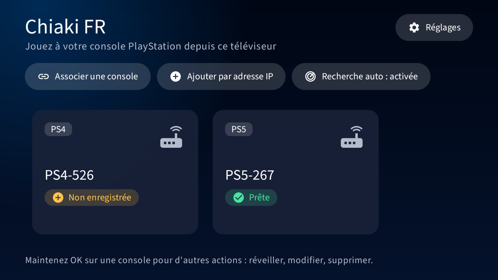
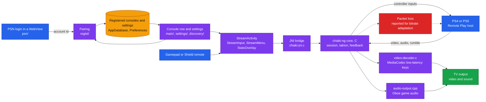

# Chiaki FR

<!-- adam-badges:start -->
[](CHANGELOG.md)
[](https://github.com/Adam-Blf/chiaki-fr/commits)
[](https://hits.sh/github.com/Adam-Blf/chiaki-fr/)
[](https://github.com/Adam-Blf/chiaki-fr/commits)
[](https://github.com/Adam-Blf/chiaki-fr)
[](COPYING)
<!-- adam-badges:end -->

Android TV build of [chiaki-ng](https://github.com/streetpea/chiaki-ng) tuned for the Nvidia Shield: French interface, PS5-style TV layout,
low latency by default, full gamepad support and in-app PSN login. Changes are listed in
[CHANGELOG.md](CHANGELOG.md), screenshots are in [docs/screenshots](docs/screenshots).



## Architecture



## Build and install

Build the debug APK with the Docker toolchain, then install it over adb:

```sh
git submodule update --init --recursive
docker build -t chiaki-ng-build scripts/android-docker
docker run --rm -v "$PWD":/src -v chiaki-gradle:/root/.gradle chiaki-ng-build ./gradlew --no-daemon assembleDebug
adb install -r android/app/build/outputs/apk/debug/app-debug.apk
```

The build targets arm64 only; pass `-PallAbis` to Gradle for the other ABIs. The application id is
`fr.beloucif.chiaki`, so the fork installs next to the original Chiaki.

## Versioning and releases

Versions follow the upstream chiaki-ng version with a `-fr.N` suffix, stored in `VERSION`. Pushing a tag
`v<VERSION>` runs `.github/workflows/release.yml`: it checks the tag against `VERSION`, publishes the
matching `CHANGELOG.md` section and attaches the arm64 debug APK built with the Docker toolchain. The
upstream desktop release workflow only runs on manual dispatch in this fork.

## Licence and credits

Chiaki FR is a fork of [chiaki-ng](https://github.com/streetpea/chiaki-ng) by Street Pea and contributors,
itself the continuation of [Chiaki](https://git.sr.ht/~thestr4ng3r/chiaki) by Florian Märkl and contributors.
It keeps the upstream licence, the GNU Affero General Public License v3.0 with the OpenSSL exception: see
[COPYING](COPYING) and [LICENSES](LICENSES). The Source Sans 3 font is under the SIL Open Font License,
see [docs/licenses](docs/licenses). This project is not endorsed or certified by Sony Interactive
Entertainment LLC, and no Sony logo or asset is shipped.

The rest of this README is the upstream chiaki-ng one.

---


# [chiaki-ng](https://streetpea.github.io/chiaki-ng/)

An open source PlayStation remote play project serving as the next-generation of Chiaki with improvements and ongoing support now that the original Chiaki project is in maintenance mode only. [Click here to see the accompanying site for documentation, updates and more](https://streetpea.github.io/chiaki-ng/).

## Discord
[chiaki-ng community Discord](https://discord.gg/tAMbRuwXDH)

## Disclaimer
This project is not endorsed or certified by Sony Interactive Entertainment LLC.

Chiaki is a Free and Open Source Software Client for PlayStation 4 and PlayStation 5 Remote Play
for Linux, FreeBSD, OpenBSD, Android, macOS, Windows, Nintendo Switch and potentially even more platforms.
