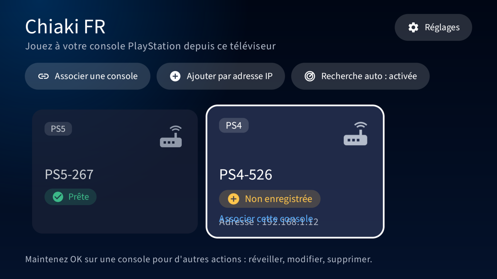

## Chiaki FR (this fork)

Android TV build of chiaki-ng tuned for the Nvidia Shield: French interface, PS5-style TV layout,
low latency by default, full gamepad support and in-app PSN login. Changes are listed in
[CHANGELOG.md](CHANGELOG.md), screenshots are in [docs/screenshots](docs/screenshots).



Build the debug APK with the Docker toolchain, then install it over adb:

```sh
docker build -t chiaki-ng-build scripts/android-docker
docker run --rm -v "$PWD":/src -v chiaki-gradle:/root/.gradle chiaki-ng-build ./gradlew --no-daemon assembleDebug
adb install -r android/app/build/outputs/apk/debug/app-debug.apk
```

The rest of this README is the upstream chiaki-ng one.

---


# [chiaki-ng](https://streetpea.github.io/chiaki-ng/)

An open source PlayStation remote play project serving as the next-generation of Chiaki with improvements and ongoing support now that the original Chiaki project is in maintenance mode only. [Click here to see the accompanying site for documentation, updates and more](https://streetpea.github.io/chiaki-ng/).

## Discord
[chiaki-ng community Discord](https://discord.gg/tAMbRuwXDH)

## Disclaimer
This project is not endorsed or certified by Sony Interactive Entertainment LLC.

Chiaki is a Free and Open Source Software Client for PlayStation 4 and PlayStation 5 Remote Play
for Linux, FreeBSD, OpenBSD, Android, macOS, Windows, Nintendo Switch and potentially even more platforms.
